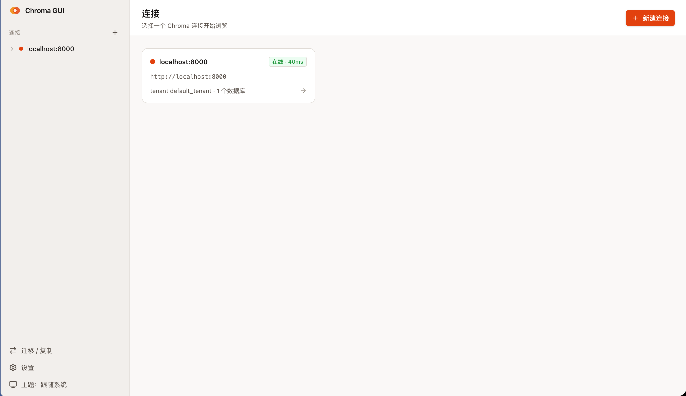
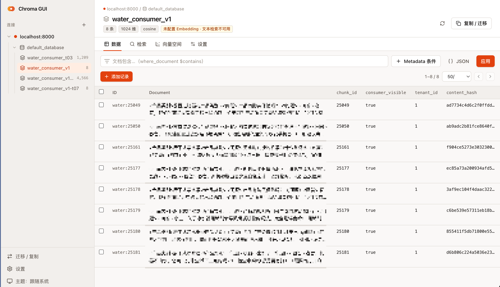
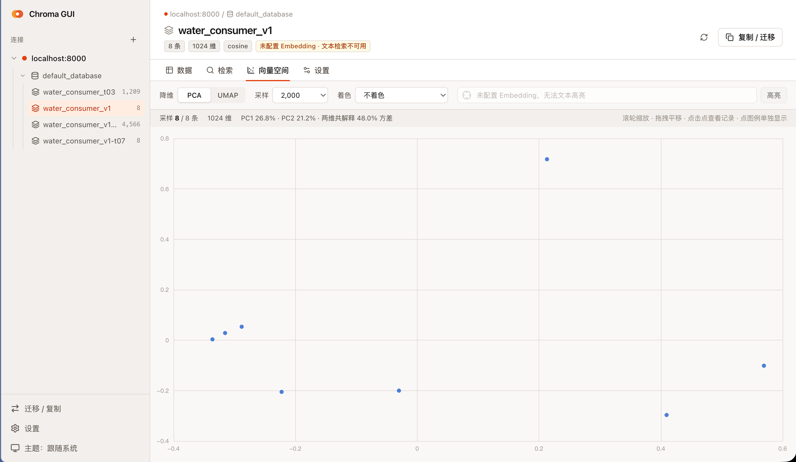

# Chroma GUI

一个在本机运行的 [ChromaDB](https://www.trychroma.com/) 1.x 网页版管理工具：浏览、过滤、编辑记录，做语义检索，把向量空间画成散点图，以及在库与库、连接与连接之间复制集合。


功能参考了 [Chroma Explorer](https://www.chroma-explorer.com/#features)，另外加了向量空间可视化和跨连接迁移。

## 截图

**连接列表**：管理多个 Chroma 连接，显示在线状态、延迟、tenant 和数据库数量。



**数据浏览**：左侧按 连接 → 数据库 → 集合 导航，顶部显示条数、维度和距离度量；表格里 metadata 自动展开成列，支持文档内容、metadata 条件和 JSON 过滤。



**向量空间**：用 PCA 或 UMAP 把向量降到二维，显示主成分的方差解释率；可以采样、按 metadata 着色，滚轮缩放、拖拽平移，点击散点查看记录。



## 功能

| | |
|---|---|
| **连接管理** | 本地 / 自建 / Chroma Cloud，可同时保存多个连接；支持 `X-Chroma-Token`、Bearer、Basic 认证；自动识别 tenant；可设为**只读连接**（服务端拦截所有写入和删除，适合浏览生产库） |
| **数据库与集合** | 新建 / 删除数据库；新建集合（距离度量、HNSW 参数、Embedding 函数）、重命名、修改 metadata 和 `ef_search`、删除 |
| **数据浏览** | 分页表格；用 metadata 条件构建器、`where_document` 或原始 JSON 过滤；批量删除、按过滤条件删除 |
| **记录编辑** | 编辑 document（自动重新计算向量）和 metadata（删掉的 key 会真正从 Chroma 里清除）；单条或批量 JSON 写入，兼容 Chroma 列格式 |
| **导入 / 导出** | 导出整个集合或当前过滤结果为 JSONL / CSV（可选含向量，流式下载）；从 JSONL、JSON、CSV 导入，字段映射可调、带预览，没有向量的记录自动计算，分批写入可取消 |
| **向量检查器** | 维度、L2 范数、统计值、逐维热力条、取值分布，一键复制向量 |
| **语义检索** | 三种查询方式：自然语言、按某条记录找相似、直接输入向量，都可以叠加过滤条件；结果显示距离，以及按距离度量换算的相似度；每个集合保留检索历史，可收藏、一键重跑 |
| **复制为代码** | 把当前的浏览或检索转成等价的 Python / JavaScript 客户端代码和 curl 命令（凭据用占位符） |
| **向量空间** | 服务端做 PCA（高维时用随机化 SVD），浏览器 Web Worker 里跑 UMAP；可按 metadata 分类或数值着色；输入文本高亮最近邻；点击散点查看记录 |
| **复制 / 迁移** | 集合可在库与库、连接与连接之间复制（比如本地 → Cloud），保留原向量、不重新计算；同库优先用 `fork`；SSE 实时进度，可中途取消 |
| **Embedding** | 内置本地模型 all-MiniLM-L6-v2；支持 OpenAI 及兼容接口（Jina、Mistral、Voyage、硅基流动、百炼、智谱等）和 Ollama。打开集合时按集合声明的 embedding function 自动匹配本地配置，也可以手动绑定 |

## 快速开始

需要 Node.js ≥ 20 和 [pnpm](https://pnpm.io/)。

```bash
git clone https://github.com/rni-l/chromadb-gui.git && cd chromadb-gui
pnpm install

pnpm build && pnpm start      # 打开 http://localhost:4580
```

在页面里点「新建连接」，填上 Chroma 地址就能用。

### 还没有 Chroma？

仓库自带一个开发用的 docker compose，Chroma 跑在 `127.0.0.1:8010`：

```bash
docker compose up -d
CHROMA_URL=http://localhost:8010 pnpm seed   # 可选：写入几个示例集合
```

`pnpm seed` 会用内置本地模型生成向量，第一次运行要下载模型；连不上 HuggingFace 时在命令前加 `HF_ENDPOINT=https://hf-mirror.com`。

### 用 pm2 常驻运行

想让服务在后台常驻、崩溃自动重启、开机自启，可以用 [pm2](https://pm2.keymetrics.io/)：

```bash
npm install -g pm2
pnpm build

pm2 start pnpm --name chromadb-gui -- start   # 环境变量写在前面即可，如 PORT=4600 pm2 start ...
pm2 save                                       # 保存进程列表
pm2 startup                                    # 按提示执行输出的命令，开机自启
```

常用命令：

```bash
pm2 logs chromadb-gui        # 查看日志
pm2 restart chromadb-gui     # 重启（更新代码后先 git pull && pnpm install && pnpm build）
pm2 stop chromadb-gui        # 停止
pm2 delete chromadb-gui      # 从 pm2 移除
```

### 用 Docker 运行

```bash
docker build -t chromadb-gui .

docker run -d --name chromadb-gui \
  -p 127.0.0.1:4580:4580 \
  -v chromadb-gui-data:/data \
  --restart unless-stopped \
  chromadb-gui
```

打开 http://localhost:4580。几点说明：

- 容器内监听 `0.0.0.0`，所以端口映射要写成 `127.0.0.1:4580:4580`，只对本机开放（原因见下面[配置](#配置)里的警告）。
- 连接、API Key 和模型缓存保存在容器的 `/data`（即 `CHROMADB_GUI_HOME`），挂一个卷才不会在重建容器后丢失。
- 容器里的 `localhost` 指容器自己。要连宿主机上的 Chroma，地址填 `http://host.docker.internal:8010`；Linux 上还需要给 `docker run` 加 `--add-host=host.docker.internal:host-gateway`。
- 连不上 HuggingFace 时加 `-e HF_ENDPOINT=https://hf-mirror.com`，或在页面「设置」里填。

### 开发模式

```bash
pnpm dev      # API :4580 + Web :4581（热更新），打开 http://localhost:4581
```

## 配置

| 环境变量 | 默认值 | 说明 |
|---|---|---|
| `PORT` | `4580` | 服务端口 |
| `HOST` | `127.0.0.1` | 监听地址 |
| `CHROMADB_GUI_HOME` | `~/.chromadb-gui` | 配置和模型缓存目录 |
| `HF_ENDPOINT` | — | HuggingFace 镜像地址，也可以在页面「设置」里填 |

> [!WARNING]
> 这是单用户的本地工具，**没有登录鉴权**。默认只监听 `127.0.0.1`。如果把 `HOST` 改成 `0.0.0.0`，能访问这个端口的人就能读写你配置过的所有 Chroma 连接。

连接凭据和 API Key 只保存在 `~/.chromadb-gui/config.json`（文件权限 0600），返回给前端前会脱敏。

## 设计要点

- **直接调用 Chroma REST API v2**（[`server/chroma-rest.ts`](server/chroma-rest.ts)），没有用官方 JS 客户端的 Collection 封装。官方封装会按集合配置去实例化 embedding function，本机没装对应的 EF 时集合就打不开。
- **向量由本工具算好后显式传给 Chroma**。浏览、过滤、删除都不依赖 embedding，只有写入文本和按文本检索才需要配置可用的 Embedding。
- **内置本地模型**第一次使用时从 HuggingFace 下载（约 90MB，缓存在 `~/.chromadb-gui/models`）。

## 项目结构

```
server/              Hono API
  chroma-rest.ts     Chroma REST v2 薄客户端
  embeddings.ts      Embedding provider，以及「集合声明 → 本地配置」的匹配
  pca.ts             PCA（精确 / 随机化 SVD）
  migrations.ts      复制 / 迁移任务
  routes/            connections · collections（记录 / 检索 / 投影）· profiles
web/src/             React 前端（Vite + Tailwind + TanStack Query + ECharts）
shared/types.ts      前后端共享类型
scripts/seed.ts      示例数据
```

## 测试

```bash
docker compose up -d
pnpm test        # PCA 单测 + 对真实 Chroma 的 API 集成测试（连不上 Chroma 时自动跳过）
pnpm typecheck
```

集成测试默认连 `http://localhost:8010`，可以用 `TEST_CHROMA_URL` 改。测试里用一个本地的假 OpenAI 兼容服务代替真实的 embedding 接口。

## 暂不支持

- 多用户部署和登录
- 其他 embedding provider（Cohere、Gemini 原生接口等）
- 3D 视图
- Parquet 导入
- Chroma 0.x

## License

[MIT](LICENSE)
